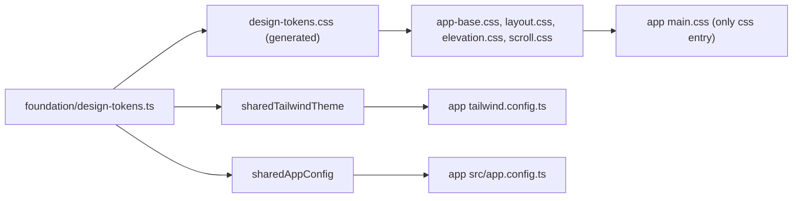

# Design System

Arc Web ships one design system for Seller, Admin, and Storefront. It is a source-level workspace package, not a published component library: `@arc/ui` resolves to `packages/ui/src`, and every app compiles the same tokens, Tailwind theme, Nuxt UI overrides, primitives, and patterns.

The system has four responsibilities:

- define the visual vocabulary once (`design-tokens.ts`)
- theme Nuxt UI components consistently (`sharedAppConfig`)
- provide generic primitives and patterns that do not know product vocabulary
- leave product-specific composition to each app

## Ownership And Layout

```text
packages/ui/
  src/
    foundation/       tokens, generated CSS, Nuxt UI config, icons, base CSS, Nuxt helpers
    primitives/       single-purpose visual atoms (icon, badge, image, radio, keycap)
    patterns/         composed generic UI (table, dialog, empty state, filters, timeline, tabs)
    shells/           app chrome shared by apps (splash, wake-up overlay, notification popover, chat)
    features/         rare cross-app feature UI
    directives/       input key filters registered as Vue directives
  scripts/
    generate-design-tokens.mjs

apps/<app>/src/
  shared/ui/          app-local, domain-neutral UI (date pickers, form wrappers)
  domains/<domain>/ui product-specific UI for that domain
```

Ownership ladder:

1. Start UI in the page or domain that needs it.
2. Promote to `apps/<app>/src/shared/ui/` when several domains in one app need it.
3. Promote to `packages/ui/` when multiple apps need the same generic primitive or pattern.

`packages/ui` components must stay free of product concepts (shop, cart, order, category, checkout). Domain-named components belong in an app. Promoting UI creates an API surface; do not promote on speculation.

## Styling Pipeline



All three apps wire the same pieces:

- `nuxt.config.ts` aliases `@arc/ui` to `packages/ui/src`, lists `packages/ui/src` in `components` (auto-import, `pathPrefix: false`, `extensions: ['.vue']`), and uses `~/app/assets/css/main.css` as the only `css` entry.
- `tailwind.config.ts` spreads `sharedTailwindTheme` and includes `../../packages/ui/src/**` in `content`.
- `src/app.config.ts` is a three-line re-export of `sharedAppConfig`.

## Design Tokens

`packages/ui/src/foundation/design-tokens.ts` is the single source of truth. It feeds `sharedTailwindTheme`, the generated `:root` custom properties in `design-tokens.css`, and the Nuxt UI theme.

Values, generated output, surface ladder, color rules, and the zinc pinning contract are documented in [`design-tokens.md`](./design-tokens.md).

Never hand-edit `design-tokens.css`; regenerate it after changing the token module:

```bash
pnpm --filter @arc/ui generate:tokens
```

## Nuxt UI Theme Layer

`packages/ui/src/foundation/app-config.ts` exports `sharedAppConfig`, merged into each app's `defineAppConfig`. It sets `ui.gray: 'zinc'`, `ui.primary: 'indigo'`, and overrides component classes so Nuxt UI matches the token layer:

- `card` and `popover` use `shadow-border` / `shadow-overlay`.
- `dropdown`, `formGroup`, `radio`, `skeleton`, `tabs`, and `table` use semantic surface, border, and text tokens.
- `button` defines the shared `subtle` variant and the `white`/`gray` outline and ghost colors.
- `pagination` and the loading icons on `select`, `input`, and `button` use the aliased icon set.
- `notifications` position and hide the Nuxt UI progress bar; `chip` and `checkbox` carry layout tweaks.

App-level changes to Nuxt UI classes belong here, not in each app's `app.config.ts`. A component that needs product-specific theming should override locally with `:ui`.

## Icons

`foundation/app-icon.constants.ts` owns every icon string:

- `ICON_NAME_BY_ALIAS` maps semantic names (`search`, `orders`, `warning`, `plus`, `arrowRight`, …) to collection-prefixed names from tabler, lucide, heroicons, uil, solar, majesticons, ph, akar-icons, and lets-icons.
- `AppIcon` renders an alias, with `size` from `xs` to `3xl` and `mode` `svg` or `css`. It is decorative by default.

Use an existing alias and `AppIcon`; do not add inline SVGs or hardcode an icon name when an alias fits.

## Components

Components under `packages/ui/src` are auto-imported into every app by filename (`status-badge.vue` → `<StatusBadge>`), and can be imported explicitly from their file path:

```ts
import StatusBadge from '@arc/ui/primitives/status-badge.vue'
import DataTable from '@arc/ui/patterns/data-table/data-table.vue'
```

`packages/ui/package.json` declares a bounded `exports` map: tier globs for `primitives`, `patterns`, `shells`, and `features`, plus explicit entries for `foundation/*` modules and `directives/input-directives`. Imports outside the map are rejected (`ERR_PACKAGE_PATH_NOT_EXPORTED`), so the tiers are the public surface; files inside a tier, such as pattern-internal composables, remain importable.

### Primitives

Seven single-purpose atoms: `AppIcon`, `LoadingSvg`, `ProductImage`, `RadioInput`, `RadioGroupInput`, `ShortcutHint`, `StatusBadge`. Their props stay presentational; read the file for the current prop surface.

### Patterns

Composed, domain-neutral UI, grouped by use:

- **Surfaces and feedback** — `AppPanel`, `AppStateBlock`, `Empty`, `SectionHeader`
- **Data** — `DataTable`, `FixedPagination`, `ScheduleCell`, `data-filter/*` (toolbar, popover, chip, multi-select panel)
- **Overlays** — `BaseDialog`, `DialogActions`
- **Navigation and progress** — `AppTabs`, `ProgressSteps`, `Timeline`
- **Form chrome** — `form/*` (rows, group card, fixed actions, selection bar)

The directory is the authoritative list: `packages/ui/src/patterns/`. Tier rules for adding a component live in `packages/ui/README.md`.

`patterns/data-filter/summary.ts` summarizes filter labels for toolbars.

### Shells

`shells/` holds shared chrome: `app-splash.vue`, `backend-wake-up-overlay.vue`, `notification-popover/`, `chat-thread-panel.vue`, `conversation/` (inbox, list, thread panels), and `auth/reset-password-shell.vue`. Use them when the same chrome must behave identically across apps; keep app-specific layout in the app.

### Directives

`directives/input-directives.ts` exports registration helpers for input key filtering: `registerAlphanumericDirective`, `registerNumericDirective`, `registerSkuDirective`, `registerMaxNumberDirective`, `registerUppercaseDirective`. Seller and Storefront register the ones they use in `src/app/plugins/`.

## Interaction Rules

- Reuse existing form, table, dialog, toast, loading, and empty-state patterns before inventing markup.
- Make mutation feedback explicit: loading, success, and failure states visible on user-facing actions.
- Reserve `:loading` for user-initiated actions. Initial fetches render skeletons, or keep the control `disabled` until its inputs resolve.
- Lock the whole form while submitting: inputs disabled or read-only, secondary actions disabled. For links use `aria-disabled="true"`, `tabindex="-1"`, and `aria-disabled:` variants.
- If a control is disabled because required data failed to load, explain it with the existing hint or tooltip pattern.
- Do not add in-app text about implementation details.

## Responsive Rules

Check mobile and desktop for every changed page. Keep button text and table content inside their containers, and keep repeated controls at stable dimensions.

## Verification

```bash
pnpm check                     # architecture + package lint/typecheck/tests + all app checks
pnpm check:architecture        # ownership, layer direction, raw gray palette scan
pnpm check:shared-ui           # duplicated app-local UI must stay identical
pnpm typecheck:packages        # package-owned typecheck for every package
pnpm test:packages             # vitest for packages, including token drift
pnpm --filter @arc/ui generate:tokens
```

Each package has its own `tsconfig.json` extending `packages/tsconfig.base.json`, which maps `@arc/*` imports to package sources. Nuxt-dependent packages declare their runtime globals in a package-local shim (`@arc/composables/nuxt-app.d.ts`, `@arc/nuxt-vue-query/nuxt-types.d.ts`, `@arc/ui/nuxt-auto-imports.d.ts`); using a new auto-imported global requires adding its declaration there, and the check fails until then. Package test files are included in the same program, so they are typechecked too.

`design-tokens.spec.ts` fails when `design-tokens.css` drifts from `design-tokens.ts`, when the semantic gray tokens stop matching zinc, or when `ui.gray` stops being `zinc`.

`scripts/check-architecture.mjs` is the styling and import boundary gate:

- apps may not import another app's source
- `shared` may not import `domains` or `app`; `domains` may not import `app`
- `packages/*` may not import app source
- raw gray palette classes and `var(--color-gray-*)` are rejected outside the token files

## Known Gaps

- `@arc/ui` has no build step or root barrel entry. `exports` is tier-level, so internals inside each tier remain importable. The source directory path is still required for Nuxt component scanning and Tailwind `content`; the `@arc/ui` Nuxt alias is now redundant for module resolution.
- `@arc/eslint-config` is plain JavaScript and has no package-owned typecheck.
- `date-picker.vue` and `date-filter/` remain copied in Seller and Admin because they depend on `dayjs` and `v-calendar`; `pnpm check:shared-ui` fails if the copies diverge. `desktop-guard.vue` is an intentional per-app copy variant.
- Dark mode has no token layer; components opt into `dark:` with zinc or raw palette classes.

## Related Docs

- [`design-tokens.md`](./design-tokens.md)
- `docs/architecture/application-structure.md`
- `docs/architecture/monorepo.md`
- `docs/fe-type-boundaries.md`
- `agent-skills/ui-conventions.md` (working rules for UI changes)
