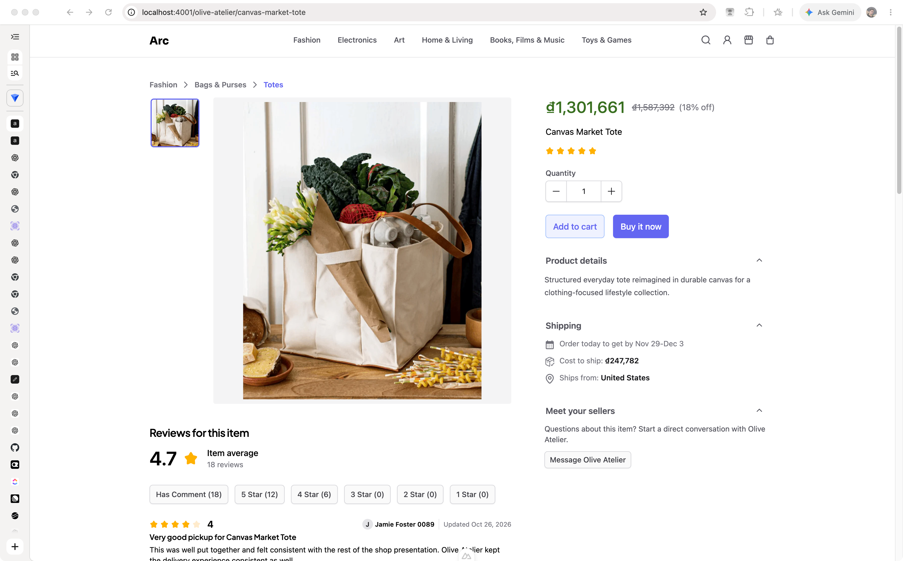

# Ticket 02 evidence

## Live product-detail layout



The screenshot shows the current product-detail shipping block with:

- `Shipping` section title
- bold delivery window
- converted `Cost to ship`
- `Ships from` country

## API evidence

- `api-us-preview.json`: US Market, USD — country rate `599`, estimate `4-8`.
- `api-vn-preview.json`: VN Market, USD — `everywhere_else` rate `1999`, estimate `6-13`.
- `api-vn-country-rate.json`: VN Market against a profile with VN and `everywhere_else` rates — VN country rate wins.

Commands used:

```bash
curl -s 'http://localhost:4000/v1/products/by-slug/olive-atelier/linen-weekend-dress' \
  -H 'X-Market-Code: US' -H 'X-Currency: USD' -H 'X-Locale: en-US' | jq '.shipping'

curl -s 'http://localhost:4000/v1/products/by-slug/olive-atelier/linen-weekend-dress' \
  -H 'X-Market-Code: VN' -H 'X-Currency: USD' -H 'X-Locale: en-VN' | jq '.shipping'

curl -s 'http://localhost:4000/v1/products/by-slug/olive-atelier/canvas-market-tote' \
  -H 'X-Market-Code: VN' -H 'X-Currency: USD' -H 'X-Locale: en-VN' | jq '.shipping'
```

## Automated coverage

- API typecheck passed.
- API focused tests: 44 passed.
- Storefront unit tests: 198 passed.
- Storefront Nuxt tests: 130 passed.
- Enum conformance test passed.

The remaining manual matrix cases (digital, missing profile, draft profile, missing FX rate) are covered by the shipping service unit/integration tests; the browser run was interrupted for the shipping-layout revision.
